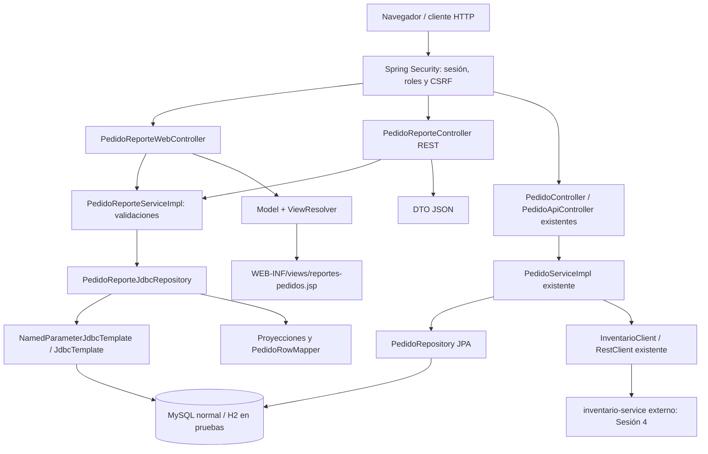

# Arquitectura PA3

La ruta de reportes no usa inventario. Se mantienen las dependencias por constructor.
El repositorio devuelve proyecciones; el servicio las convierte a modelos de dominio
y REST a DTO. El RowMapper existente transforma filas de la búsqueda en Pedido.
Seguridad precede al controlador: autenticar no concede por sí solo permiso de registro.
